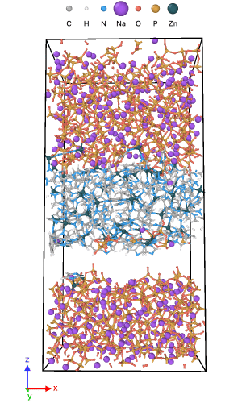

# ZIF-62 / 40NaP hybrid glass: crack healing by machine-learning MD

Simulation code for the molecular-dynamics part of the paper on self-healing ZIF-62 / phosphate (40Na₂O–60P₂O₅, "40NaP") hybrid glasses.

The workflow:
1. makes the two parent glasses by melt-quenching;
2. stacks them into a layered composite and anneals it so that Zn–O–P bonds form at the interfaces;
3. opens a crack along one ZIF/NaP interface;
4. heals it at 500–800 K;
5. measures how much of the interface bonding and stiffness comes back.

All MD uses LAMMPS with the MACE-MH-1 foundation potential (matpes_r2SCAN head, float64) through the ML-IAP interface on one GPU.

<p align="center">
  
  <br>
  <em>Healing of the interfacial crack at 800 K (seed 1).</em>
</p>

> **Citation:** if you use this code, please cite the paper (reference to be added on publication) and the software listed under [Acknowledgements](#acknowledgements).

---

## Repository layout

| folder | content |
|---|---|
| `config/site.sh` | **the one file to edit for your machine**: paths, GPU architecture, module loads |
| `install/` | set up the python environment, build LAMMPS (KOKKOS + ML-IAP), export the MACE model, check LAMMPS against ASE |
| `lammps/` | LAMMPS input scripts for every MD stage |
| `scripts/` | structure building, cracking, integrity checks and analysis (python) |
| `run/` | `run_step.sh` (one workflow step), PBS / SLURM wrappers, and `paper_runs.sh` (the exact runs behind the paper) |
| `post/` | post-processing of a finished run directory into the tables and figure data of the paper |
| `data/` | the starting ZIF-62 crystal (`data/structures/input/`) and the simulation data: final structures, two trajectories, thermodynamic curves, elastic tensors and the result tables (see `data/README.md`) |
| `media/` | movies of the healing runs (GIF/MP4) |

---

## 1. Installation

**Requirements**
- Linux with an NVIDIA GPU. The paper used A100s; any GPU with FP64 support works.
- CUDA toolkit, GCC ≥ 10.4, MPI, conda.

**Steps**

1. Edit `config/site.sh`: install paths, `KOKKOS_ARCH` / `CUDA_ARCH`, and the `load_modules` function for your cluster.
2. Run the install steps:

```bash
bash install/01_setup_env.sh      # login node: conda env (environment.yml), ML-IAP extras, LAMMPS source, GPU-D3 patch
bash install/02_build_lammps.sh   # GPU node: LAMMPS with KOKKOS (CUDA) + ML-IAP + PYTHON
bash install/03_export_model.sh   # export MACE-MH-1 (matpes_r2scan, float64) to <SW>/models/*-mliap_lammps.pt
```

**Versions used for the paper**

| software | version |
|---|---|
| LAMMPS | `patch_4Jul2026` |
| torch | 2.12.0 (CUDA 13.0) |
| mace-torch | 0.3.16 |
| cuEquivariance | latest at install time |
| cupy | 14.2 |
| cython | 3.0.11 |

**Optional check:** `install/04_validate_vs_ase.py` compares the energy, forces and stress from LAMMPS with the ASE `MACECalculator` for any structure. FP64 should agree to better than 0.1 meV/atom and 1 meV/Å. `install/in.bench` is a speed and NVE-drift benchmark.

The GPU-D3 dispersion (SevenNet `pair_style d3`) is optional. The composite and healing results do not use D3; it was only used for the free-box 40NaP glass-transition run. Set `WITH_D3=0` to skip it.

**Analysis only:** for the post-processing on a laptop, `pip install -r requirements-analysis.txt` is enough.

---

## 2. Running the workflow

Every step writes its own sub-folder into the current **run directory**. Run the steps in this order:

```bash
export REPO=/path/to/this/repo
mkdir -p ~/zifnap_run && cd ~/zifnap_run
STEP=zif                       bash $REPO/run/run_step.sh    # on a GPU node, or via run/pbs_job.pbs / run/slurm_job.sh
STEP=nap MODE=layer            bash $REPO/run/run_step.sh
STEP=composite                 bash $REPO/run/run_step.sh
STEP=heal THEAL=800 SEED=1     bash $REPO/run/run_step.sh
STEP=elastic ITEMS=pristine+cracked+contact+heal_B_T800_s1 bash $REPO/run/run_step.sh
```

`run/paper_runs.sh` lists every job of the paper with its wall time on one A100.

| step | input script | what it does | output folder | A100 time |
|---|---|---|---|---|
| `zif` | `in.melt_zif` | ZIF-62 2×2×1 crystal (1184 atoms, 112 Im + 16 bIm) → glass (see below) | `zif221_B/` | 12–15 h |
| `zif CELL=222` | `in.melt_zif` | same protocol on the 2×2×2 crystal (2368 atoms), used for the ZIF-62 T_g | `zif222_B/` | 1–2 days |
| `nap MODE=layer` | `in.quench_zifnap` | 40NaP, 2160 atoms, lateral box fixed to the ZIF layer | `nap_layer_B/` | ~8 h |
| `nap MODE=iso POT=A` | `in.quench_zifnap` | free-box 40NaP with MACE + D3 at 0 bar, used for T_g | `nap_iso_A/` | ~9 h |
| `composite` | `in.composite_anneal` | build and anneal the NaP │ ZIF │ NaP composite (see below) | `composite_B/` | ~17 h |
| `heal` | `in.heal_r1` | crack at interface I1 and heal it (see below) | `heal_B_T<T>_s<seed>/` | 10–20 h |
| `elastic` | `in.elastic` | 0 K stiffness tensor from ±0.5 % strains of the minimised cell; items `pristine`, `cracked` (the crack is identical in every run), `contact` (after 5 ps at 300 K) and `heal_B_T<T>_s<seed>` | `elastic_B/` | — |
| `tension` | `in.tension` | optional uniaxial tension along z | `tension_B/` | — |

**`zif`: ZIF-62 glass**
1. Melt at 1500 K until ≥ 50 % of the original Zn–N bonds have exchanged and the Zn MSD is ≥ 10 Ų. `scripts/zif_melt_check.py` tests this between hold blocks.
2. Cool to 1300 K while raising the pressure to 1 GPa.
3. Quench at 5 K/ps at 1 GPa.
4. Release to 0 bar over 20 ps at 300 K.

**`nap MODE=layer`: 40NaP glass**
- Random start at 2000 K, mixed for 50 ps.
- Quench at 5 K/ps (dt = 2 fs) at 1 GPa, then release at 300 K.
- Barostat on z only.

**`composite`: composite build and anneal**
- Build: `build_composite.py` stacks NaP │ ZIF │ NaP, 3344 atoms, 3.24:1 by weight.
- Anneal:
  - 300 → 1200 K at 20 K/ps;
  - 40 ps at 1200 K;
  - quench at 5 K/ps at 1 GPa;
  - release, 20 ps anneal, 10 ps NVT sampling, `box/relax`.

**`heal`: crack and heal**
- **Crack:** `make_crack.py --axis z --plane auto --interface 1 --gap 5`. The plane is placed where it cuts the most Zn–O–P bonds (15).
- **Heal:**
  1. 5 ps at 300 K with L_z fixed.
  2. Heat to `THEAL` at 20 K/ps.
  3. Hold `THOLD` ps with `PHEAL` = 1000 bar on z (0 bar in x and y).
  4. Quench at 20 K/ps.
  5. 10 ps anneal, 5 ps sampling, `box/relax`.

**Potential choice (`POT`)**
- `POT=B` (default) is used for every composite, crack and healing result: MACE-MH-1 without D3, with the glasses quenched at 1 GPa and released at 300 K. The 1 GPa quench compensates the missing dispersion and reproduces the experimental X-ray structure factors best.
- `POT=A` (MACE + D3, 0 bar) is only used for the 40NaP T_g.

**Safety checks**
- `scripts/check_integrity.py` runs after every build, crack and heal. It checks that every linker is an intact Im or bIm, P is four-coordinated, there are no O₂ molecules and no atomic overlaps.
- A step never overwrites an existing run unless `FORCE=1`.

**Paper settings:** T_heal = 500 and 600 K (below both MD T_g, 200 ps hold) and 700 and 800 K (100 ps hold), each with seeds 1–3. Extra options: `PHEAL=0 SUF=_p0` for healing without contact pressure, `GAP=` for the crack width.

---

## 3. Post-processing → paper data

Run these on the finished run directory. Each writes CSV files into `--out` (default `analysis/`).

```bash
cd $REPO/post
python interface_table.py  ~/zifnap_run --out ~/zifnap_run/analysis
python healing_kinetics.py ~/zifnap_run --out ~/zifnap_run/analysis
python crack_opening.py    ~/zifnap_run --out ~/zifnap_run/analysis --plot
python zn_environment.py   ~/zifnap_run --out ~/zifnap_run/analysis [--exp exp_residual.csv]
python elastic_table.py    ~/zifnap_run --out ~/zifnap_run/analysis --plot
```

| script | output | used for |
|---|---|---|
| `interface_table.py` | Zn–O–P bonds, IBD (per nm²), ICC, P_ZnOP for the crack plane, I1, I2 and total, for pristine, cracked, contact (5 ps at 300 K) and healed (every seed); means per T; density profiles | IBD/ICC tables (SI), healed state vs T |
| `healing_kinetics.py` | the same metrics every 1 ps during healing | healing kinetics |
| `crack_opening.py` | interfacial void width over the full heat → hold → quench cycle, with T(t) | Fig. 6C |
| `zn_environment.py` | Zn–X partial g(r) and coordination numbers; X-ray-weighted ΔD_Zn(r), composite − ZIF | Fig. 6D, Fig. 6B |
| `elastic_table.py` | C_ij, E_x, E_y, E_z, B, G, E (Voigt–Reuss–Hill) per structure; recovery per T | elastic recovery |

**Definitions** (`scripts/heal_analysis_r1.py`)

**Bond cutoffs:** Zn–O ≤ 2.5 Å, Zn–N ≤ 2.5 Å, P–O ≤ 2.05 Å.

**Interface metrics:**
- **Zn–O–P:** a Zn–O bond whose O is bonded to P.
- **IBD:** Zn–O–P per nm² of interface.
- **P_ZnOP:** Zn–O–P / (Zn–N + Zn–O), in %.
- **ICC:** % of Zn with at least one Zn–O–P.

**Halves and crack plane:**
- Zn are split into the cracked half (I1) and the intact half (I2) by the circular mean of Zn along z.
- "Across the crack plane" counts bonds whose two atoms were on opposite sides of the cut. The side labels come from `make_crack.py` (`crack_side.txt`).

**Void width:** Σ dz · max(0, 1 − ρ(z)/1.5 g cm⁻³), summed over 0.5 Å slices 3–20 Å below the ZIF centre.

**Other analysis tools in `scripts/`**

| script | purpose |
|---|---|
| `tg_bayes.py` | T_g from cooling curves (Bayesian two-line change point). Examples: `python scripts/tg_bayes.py nap_iso_A/cooling_curve.dat:2160:40NaP --tmax 1300 --tgmin 400 --tgmax 1100 --out tg_40nap` (652 K) and `python scripts/tg_bayes.py zif222_B/cooling_curve.dat:2368:ZIF62 --tmax 1280 --out tg_zif62` (ZIF-62 at 1 GPa: T_g(PE) 862 K [804–901]; V(T) has no resolvable kink at 1 GPa) |
| `zif_tg_dynamics.py` | Zn–N exchange and Zn mobility on cooling |
| `xrd_compare.py` | X-ray S(Q) and D(r) of MD glasses vs experiment (same Q range and Lorch window for both) |
| `desy_reduce.py` | reduce experimental total-scattering data to S(Q) and D(r) |
| `composite_pdf.py` | two-phase fit of composite PDFs |
| `analyze_glass.py` | quick structural summary (density, CN, Qⁿ, linker integrity) |
| `center_dump.py` | centre a dump on the ZIF layer for visualisation (OVITO) |
| `void_width_dump.py` | void width per frame of any dump |
| `heal_temps.py` | place healing temperatures inside the MD T_g window |

Experimental scattering data are not part of this repository.

---

## 4. Data

`data/` holds the outcome of the paper's runs: the final structures (parent glasses, composite
start and annealed glass, the cracked cell, the contact state after 5 ps at 300 K and all 12
healed structures), two trajectories
(the composite anneal at 1200 K and the 800 K healing run, ZIF-centred), the thermodynamic
records, the elastic tensors and the result tables (interface bonding per structure and per
nm², healing summary per temperature, elastic moduli). `data/README.md` documents every file
and its units. Full trajectories (several GB) are not archived; they can be regenerated with
Section 2, and `post/` recomputes every table from them.

## Notes and limitations

- **Time step:** 1 fs for everything containing ZIF (H atoms), 2 fs for pure 40NaP.
- **Thermostat and barostat:** Nosé–Hoover (`fix npt` / `fix nvt`). Damping constants: T_damp 0.2 ps and P_damp 2 ps for the melt-quench runs; 0.1 ps and 1 ps for the composite anneal and healing.
- **Time scale:** MD covers ~100–200 ps of healing. It captures the fast re-bonding at contact, not the slow, flow-controlled healing seen experimentally over minutes to days.
- **Contact pressure:** the 0.1 GPa applied normal to the crack during healing is a protocol choice. `PHEAL=0` runs the same protocol without it.
- **Densified glasses:** the 1 GPa-prepared glasses relax partly during healing (in-plane 0 bar). This lowers density and in-plane stiffness independently of the crack.

## Acknowledgements

- LAMMPS: Thompson et al., *Comput. Phys. Commun.* 271, 108171 (2022).
- MACE: Batatia et al., *NeurIPS* 2022. The MACE-MH-1 foundation model is distributed by the ACEsuit / mace-foundations project.
- ML-IAP / KOKKOS interface for MACE in LAMMPS.
- GPU-D3: SevenNet, MDIL-SNU.
- ASE: Larsen et al., *J. Phys.: Condens. Matter* 29, 273002 (2017).
- ZIF-62 starting structure: built from CSD deposition 2130183 (doi:10.5517/ccdc.csd.cc29hml1), bIm fraction 0.25, as a 2×2×1 supercell.
- Melt–quench protocol (`in.quench_zifnap`): adapted from the GlassDB adaptive quench (v5).

## License

MIT (see `LICENSE`).
